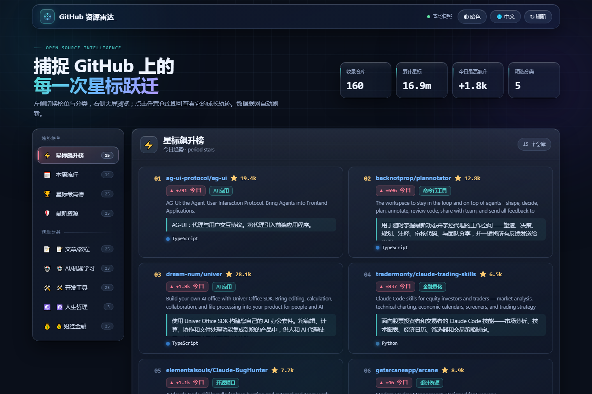
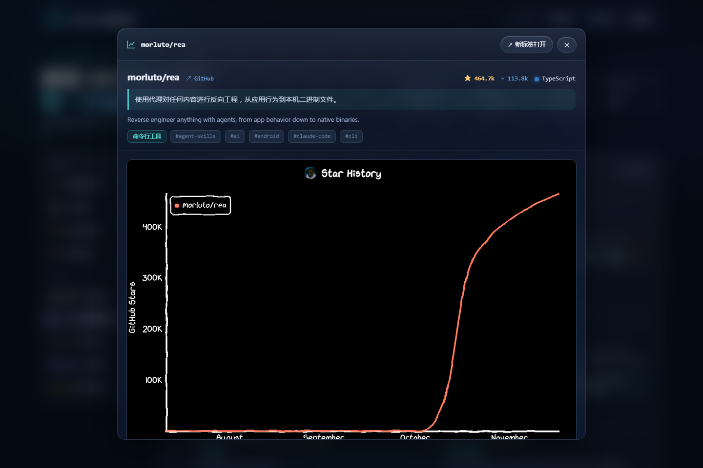

# GitHub 资源雷达 · Signal

> 捕捉 GitHub 上的每一次星标跃迁。
>
> 一个把「星标飙升榜、本周流行、星标最高榜、最新资源」与五个精选分类装进同一块工作台式大屏的单页数据面板。数据每 6 小时自动刷新，悬停即见成长轨迹，点开即读完整简介。

[](https://davin-96.github.io/github-radar-signal/)
[](https://github.com/Davin-96/github-radar-signal/releases/latest)

---

## 预览

**亮色 · 星标飙升榜**


**暗色 · 同一数据，另一套主题**



**悬停仓库名 · 就近弹出星标走势**


**点击卡片 · 完整简介 + 星标走势大图**



---

## 这是什么

一个**零依赖的单文件数据面板**。`index.html` 一个文件包含全部 HTML / CSS / JS 与数据快照——不需要服务器、不需要构建、不需要联网，双击就能看。

打开后左侧是榜单与分类导航，右侧是大屏仓库列表：

- **四个榜单**：⚡ 星标飙升榜（今日 `period_stars`）、🔥 本周流行、🏆 星标最高榜、🆕 最新资源
- **五个精选分类**：文章/教程、AI/机器学习、开发工具、人生哲理、财经金融
- **中文简介**：每条仓库附中文一句解读，中英双语可切换
- **星标走势**：鼠标悬停仓库名，就近浮出 mini 走势图；点击卡片展开大图 + 完整简介 + 语言/标签

顶部四个数字随数据更新：收录仓库、累计星标、今日星标飙升、精选分类数。

---

## 快速开始

### 方式一 · 在线版（推荐）

打开 <https://davin-96.github.io/github-radar-signal/>。

数据由 **GitHub Actions 每 6 小时自动抓取一次**（Trending 日榜/周榜 + GitHub Search API），写入 `assets/live.json` 并提交到仓库。页面打开时自动读取该文件刷新全部榜单与分类，右上角「↻ 刷新」可手动重读。想立刻抓取最新数据，也可在仓库 Actions 页面手动触发 `Refresh radar data` 工作流。

页面只读同域的 `live.json`，**不直接请求 GitHub API**，因此访客不会遇到 GitHub 未认证接口的限流（403）；读取失败时自动回退到内嵌快照，不影响浏览。

### 方式二 · 离线版

从 [Releases](https://github.com/Davin-96/github-radar-signal/releases/latest) 下载 `GitHub-Radar-Signal-v1.0.0.zip`：

1. 解压到任意目录
2. 双击 `index.html`，浏览器直接打开

无需联网、无需服务器。离线状态使用**内嵌数据快照**（快照时间显示在顶部状态栏），榜单与分类完整可浏览。

> 星标走势图来自 star-history.com 公共服务，需联网加载；离线或加载失败时，「新标签打开」仍可跳转 GitHub 查看项目。

---

## 操作速查

| 操作 | 效果 |
|---|---|
| 左侧点榜单 / 分类 | 切换右侧大屏列表 |
| 鼠标悬停仓库名 | 就近弹出星标走势 mini 图 |
| 点击仓库卡片 | 打开详情弹窗：完整简介 + 走势大图 |
| 右上角「🌐 中文 / English」 | 中英双语切换（记忆到 localStorage） |
| 右上角「🌙 暗色 / ☀️ 亮色」 | 明暗主题切换（记忆到 localStorage） |
| 右上角「↻ 刷新」 | 重新读取最新 `live.json`（在线版有效） |
| 顶部状态标签 | `本地快照` / `实时数据` / `降级快照` |

---

## 数据来源与口径

- **榜单与分类**（在线实时）：GitHub Actions 每 6 小时抓 GitHub Trending（日榜/周榜）+ GitHub Search API（`stars:>10000`、`created:>14d stars:>50`、各 topic 检索），写入 `assets/live.json`；页面读同域文件，不直连 GitHub API，无限流问题
- **内嵌快照**（离线兜底）：`index.html` 内嵌一份构建时快照，供 `file://` 离线打开与实时数据不可用时回退；快照时间显示在页面顶部
- **中文简介**：新抓仓库的描述经免密钥翻译链生成中文（Google → MyMemory → 旧缓存 → 英文原文），翻译结果缓存在 `scripts/translated.json`，已译条目不重复翻译
- **星标走势图**：来自 [star-history.com](https://star-history.com/) 公共服务，按仓库全名在线加载 SVG
- **今日星标飙升**（`period_stars`）：来自 Trending 日榜口径，非精确 24h 增量，仅供相对比较
- **7 日增速**（`growth_7d`）：需连续抓取积累，当前沿用内嵌快照的历史值，随后续运行逐步更新
- 本项目为开源项目情报的**聚合展示**，星标数为抓取时点的近似值，不构成任何排名或推荐意见

---

## 目录结构（仓库精简版）

```
.
├─ index.html                  成品：全部 HTML/CSS/JS + 内嵌快照，单文件自包含
├─ README.md                   本文件
├─ assets/
│  ├─ live.json                【实时数据】Actions 每 6 小时更新，页面读取此文件
│  ├─ data.json / data_slim.json 构建时的原始快照（供抓取脚本复用中文简介）
│  └─ original.html           初版设计存档
├─ scripts/
│  ├─ fetch_live.py           抓取脚本：Trending + Search API → live.json
│  ├─ translate.py            免密钥翻译降级链
│  └─ translated.json         翻译缓存（避免重复翻译）
├─ .github/workflows/
│  └─ refresh-data.yml        定时任务：每 6 小时抓取并提交
├─ preview/                    定稿预览图（v4）
│  ├─ v4-light.png
│  ├─ v4-dark.png
│  ├─ v4-hover.png
│  └─ v4-modal.png
└─ .nojekyll                   告知 GitHub Pages 跳过 Jekyll 构建
```

`build/` 是界面构建与验证脚本，不随运行时依赖，保留在仓库供溯源。

---

## 下载

- **在线版**：<https://davin-96.github.io/github-radar-signal/>
- **离线包**：[Releases · v1.0.0](https://github.com/Davin-96/github-radar-signal/releases/tag/v1.0.0) → `GitHub-Radar-Signal-v1.0.0.zip`

---

## License

MIT
